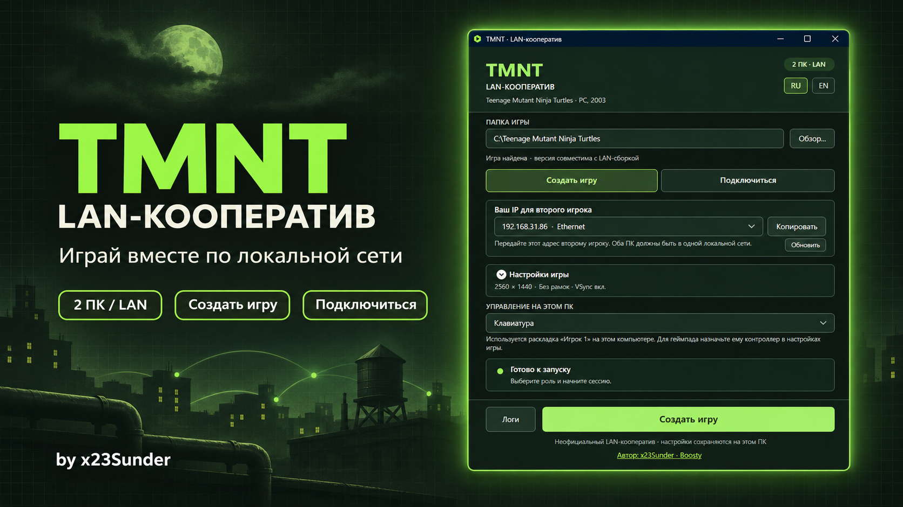

# TMNT 2003 LAN Co-op

Play **Teenage Mutant Ninja Turtles (PC, 2003)** together on **two PCs over a local network**.

**By [x23sunder · Retro Co-op](https://boosty.to/x23sunder/)** · [Русский](README.md)

**[Download v0.14](https://github.com/hallejuah/tmnt-2003-lan-coop-releases/releases/download/v0.14/TMNT_LAN_v0.14.zip)** · [All releases](https://github.com/hallejuah/tmnt-2003-lan-coop-releases/releases)

The archive contains **one TMNTLanLauncher.exe**, launcher version **1.5.0**. No PS1/CMD scripts or separate DLL installation is required.

## Features

- Two-player story co-op on separate PCs over LAN.
- Each player uses their own keyboard or gamepad; mixed devices are supported.
- Host and join through the launcher using IPv4.
- Instant RU / EN interface switching.
- Per-PC resolution, fullscreen, borderless/windowed modes and VSync.
- Separate LAN progress in **CoopLab**.

The original shared camera is retained. The host controls shared menus. Display options are built in; the standalone Community Launcher is not required for LAN play.

## Quick start

1. Install a compatible PC copy of TMNT 2003 on both computers. Requires **Windows 10/11**, **.NET Framework 4.8** and the same LAN.
2. Place **TMNTLanLauncher.exe** beside **TMNT.EXE** on each PC. Use **Browse** if the game is not detected.
3. Set display options **before launching** and choose your input device. Each PC can use different settings.
4. **PC1:** choose **Host game** and share the displayed IPv4 address.
5. **PC2:** choose **Join game**, enter PC1's IPv4 address and connect.
6. The host selects story mode and **two players**. Each player then selects their character.

The mod uses the local **Player 1** bindings on both PCs. For a gamepad, configure it for Player 1 in the regular game first, save and close the game, then select **Gamepad** in the LAN launcher. **Configure Player 1 on PC2 as well**; the mod maps that input to the second network character. PC1 can use a keyboard while PC2 uses a gamepad, or vice versa.

## Experimental build

The full campaign is still being tested. Hangs and desynchronization may occur. Reconnection to an existing session and independent cameras are not implemented. Retry if loading stalls.

LAN progress is stored in **CoopLab**. End the session before changing display settings in the launcher. In-game settings access is blocked because changing resolution there can crash the game.

For a bug report, use **Logs** on both PCs and preserve both session folders. [Report the issue](https://github.com/hallejuah/tmnt-2003-lan-coop-releases/issues/new) with the version, Windows, level, input devices and steps leading to the problem.

**[Support development on Boosty](https://boosty.to/x23sunder/)** · [Standalone Community Launcher](https://github.com/hallejuah/tmnt-2003-launcher-releases)

This repository provides releases and documentation. Mod source code is not published here. The game is not included. Unofficial project; TMNT and game assets belong to their respective owners. Description and artwork are adapted from the author's Boosty post.
