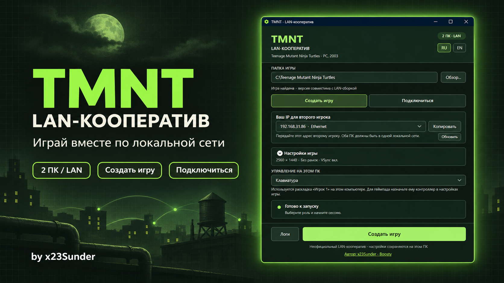

# TMNT 2003 LAN Co-op

Любимые черепашки — теперь с совместным прохождением **на двух компьютерах по локальной сети**. Экспериментальный мод для **Teenage Mutant Ninja Turtles (PC, 2003)**.

**Автор: [x23sunder · Retro Co-op](https://boosty.to/x23sunder/)** · [Пост на Boosty](https://boosty.to/x23sunder/posts/188b99e8-d2b8-4611-8eea-edd11ffa74a9) · [English](README.en.md)

## Скачать

**[Скачать TMNT 2003 LAN Co-op v0.14](https://github.com/hallejuah/tmnt-2003-lan-coop-releases/releases/download/v0.14/TMNT_LAN_v0.14.zip)** · [Все релизы](https://github.com/hallejuah/tmnt-2003-lan-coop-releases/releases)

В архиве — **один TMNTLanLauncher.exe**. Скрипты PS1/CMD и дополнительные DLL устанавливать не нужно. Версия лаунчера — **1.5.0**. Исходный код мода здесь не публикуется.

## Возможности

- Сюжетное прохождение вдвоём по LAN: каждый играет на своём ПК.
- Своя клавиатура или геймпад у каждого игрока. Можно сочетать клавиатуру на ПК1 и геймпад на ПК2.
- Создание игры и подключение по IPv4 через лаунчер.
- Русский и английский интерфейс — переключатель **RU / EN**.
- Разрешение, полноэкранный режим, окно без рамки, обычное окно и VSync.
- Отдельные настройки графики на каждом ПК и отдельный LAN-прогресс в **CoopLab**.

Камера остаётся общей, как в оригинале. Общими меню управляет хозяин сессии. Графические возможности уже встроены в LAN-лаунчер — отдельный Community Launcher для него не нужен.

## Как установить и запустить

1. Установите совместимую **TMNT 2003** на обоих компьютерах и подключите их к одной локальной сети. Нужны **Windows 10/11** и **.NET Framework 4.8**.
2. На каждом ПК положите **TMNTLanLauncher.exe** рядом с **TMNT.EXE**. Если папка не определилась, укажите её через **«Обзор»**.
3. В **«Настройках игры»** выберите разрешение, режим окна и VSync **до запуска сессии**. Выберите своё устройство управления. Параметры на двух ПК могут отличаться.
4. **ПК1:** нажмите **«Создать игру»** и передайте отображаемый IPv4 второму игроку.
5. **ПК2:** выберите **«Подключиться»**, введите IPv4 первого ПК и запустите подключение.
6. Хозяин выбирает сюжетный режим и **двух игроков**. Затем каждый выбирает своего персонажа.

Подробности обновления и установки: [INSTALL-RU.txt](INSTALL-RU.txt).

### Клавиатура и геймпад

Каждый выбирает своё устройство в своём лаунчере. Используется управление локального **«Игрока 1»** на каждом компьютере.

Для геймпада сначала запустите обычный **TMNT.EXE**, настройте геймпад для **«Игрока 1»**, сохраните настройки и закройте игру. Затем выберите **«Геймпад»** в LAN-лаунчере. **На ПК2 тоже настраивается «Игрок 1»** — мод сам назначит этот ввод второму персонажу в совместной игре. Если геймпад уже работает за первого игрока, повторная настройка не нужна.

## Сохранения, ограничения и ошибки

LAN-копия игры и прогресс находятся в **CoopLab** внутри папки игры. Настройки управления готовьте в обычной игре до сетевого запуска. Для изменения графики завершите LAN-сессию и используйте лаунчер: вход в игровые настройки заблокирован из-за сбоя смены разрешения.

**Это экспериментальная v0.14.** Полное прохождение ещё проверяется; возможны зависания и рассинхронизация. Переподключение к текущей сессии и независимая камера не реализованы. При неудачной загрузке попробуйте повторный запуск.

Если возникла проблема, нажмите **«Логи»** в лаунчере и сохраните журналы проблемной сессии **с обоих ПК**. В [сообщении об ошибке](https://github.com/hallejuah/tmnt-2003-lan-coop-releases/issues/new) укажите версию, Windows, уровень, действия перед сбоем и устройства управления.

Мод принимает проверенные версии игрового EXE. Если лаунчер сообщает о несовместимости, другая сборка игры пока не поддерживается.

## Поддержать проект

Мод распространяется бесплатно. **[Boosty x23sunder](https://boosty.to/x23sunder/)** — новости, прогресс разработки и добровольная поддержка новых кооперативных модов для ретроигр.

Для отдельного запуска обычной игры с современными параметрами экрана есть **[TMNT 2003 Community Launcher](https://github.com/hallejuah/tmnt-2003-launcher-releases)**.

Описание и иллюстрация адаптированы из публикации автора на Boosty. Игра в комплект не входит. Проект неофициальный; права на TMNT и игровые материалы принадлежат их владельцам.
